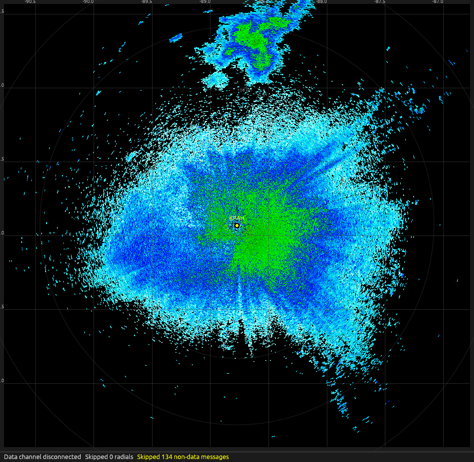

# oxrad

A free desktop weather, radar, and environmental observation workstation, written in Rust.



The screenshot is historical and does not show the current build.

oxrad runs on Linux, macOS, and Windows through `eframe` and `wgpu`. It has no account, subscription, advertisement, or paid tier. It is licensed under GPLv3.

## Status

This is a pre-release build. The radar display works. The product around it does not yet meet the standard of a professional workstation.

| Area | State |
|---|---|
| NEXRAD Level II decode and display | Working |
| Radar products and tilts | Working: seven moment products and every complete sweep, plus vertically integrated liquid and echo tops computed from the whole volume, and storm-relative velocity against a storm motion the chaser sets |
| Radar history and playback | Working: eight recent volumes, loop, scrub |
| Offline vector basemap | Working: countries, settlements, admin-1 boundaries, rivers, major highways |
| Global radar composite | Working: RainViewer, two-hour loop |
| Forecast | Working: Open-Meteo, global |
| Place search | Working: live partial and transposed names via Photon; proximity ranking absent |
| Warnings | United States only |
| Earthquakes | Working: USGS global feeds by hour, day, and week, with depth and magnitude-scaled symbols, list, and provider event pages |
| River discharge | Working: Open-Meteo flood service (GloFAS) at the map centre, three weeks behind and one week ahead, drawn as a hydrograph with the forecast and the ensemble range |
| Satellite imagery | Working: ten NASA GIBS layers — true colour, cloud-top temperature and height, aerosol optical depth, IMERG precipitation, land-surface and sea-surface temperature, ocean chlorophyll, snow cover, and vegetation index — each a provider composite over six days of archive, drawn under the vector map |
| Geomagnetic activity | Working: NOAA planetary K index for two days past and two days ahead, with measured, estimated, and predicted values drawn differently, the storm scale, and the live solar wind at L1 |
| Air quality | Working: Open-Meteo CAMS modelled concentrations at the map centre — the United States and European indices, PM2.5, PM10, ozone, nitrogen dioxide, sulphur dioxide, and carbon monoxide — with an hourly index chart for the day behind and two days ahead |
| Climate | Working: ERA5 reanalysis at the map centre since 1991, with this calendar month's mean, its departure from a baseline computed from 1991–2020 in the same record, its rank among the years, precipitation against the normal, and a chart of every year's departure |
| Wildfires | Working: NIFC WFIGS mapped perimeters for current incidents — drawn as outlines where they are large enough to see and as markers where they are not, with the nearest fires, their acreage and containment, and the largest in the country |
| Storm environment | Working: model convective energy, inhibition, lifted index, freezing level, and the surface-to-500 hPa wind difference at the map centre, hour by hour for two days, with a chart that marks the levels at which storms become possible |
| Radar outside the United States | RainViewer composite only; no national Level II adapter |
| Units selection | Partial: distance and temperature convert; other quantities do not |
| Light theme | Implemented for chrome, basemap, and radar canvas; two map controls keep their dark fill |
| Layer management | Not implemented |
| Radar color tables | Implemented: five tables, persisted; the global raster keeps its provider palette |
| Performance measurement | Not taken |

Do not use this build for safety decisions. Coverage, warnings, and geographic detail are incomplete.

The authoritative status record is [ROADMAP.md](ROADMAP.md). Requirements are in [docs/PRODUCT_REQUIREMENTS.md](docs/PRODUCT_REQUIREMENTS.md). Architecture is in [docs/ARCHITECTURE.md](docs/ARCHITECTURE.md).

## Build

```
cargo build --release --locked
```

Linux needs an X11 or Wayland client library, `libxkbcommon`, and a Vulkan loader and driver.

## Run

```
cargo run --release
oxrad --site KTWX
```

`--site` starts with that NEXRAD station instead of the saved one. `--help` prints usage.

## Use

The window has three regions.

The left rail holds place search, station selection, product and tilt, radar history, and active warnings. The centre is the workspace, switched between Radar and Map. The right panel holds the forecast for the selected place and the selected alert detail. The status bar names the station, product, scan time, scan age, gate counts, and provenance.

A town and a radar station are separate selections. Searching a town sets the forecast point. It also selects the nearest supported radar station, and changing the station afterwards leaves the forecast point unchanged.

Radar history pauses live acquisition while a scan is reviewed. Returning to live starts a fresh acquisition.

Map view overlays the selected station and up to three nearby stations when their scans fall within six minutes of the selected scan. Stations outside that window are withheld and named. This is a time-bounded overlay, not a value-composited mosaic.

The header Colors control selects the radar color table: Standard, Deuteranopia, Protanopia, Tritanopia, or High contrast. The selection persists and recolors both the radar mesh and its legend.

## Configuration and stored data

| Path | Contents |
|---|---|
| `~/.oxrad/config.toml` | Selected site and saved place |
| `~/.oxrad/stations.json` | Last station directory and its save time |
| `~/.oxrad/cache/responses/v1` | Bounded, integrity-checked response cache |

The cache holds up to 256 entries and 128 MiB. Every body is verified against its SHA-256 digest before use.

## Data sources

| Source | Use | Coverage | Licence |
|---|---|---|---|
| Unidata NEXRAD Level II archive | Radar volumes | United States WSR-88D | Public domain |
| National Weather Service station directory | Station discovery | United States and territories | Public domain |
| National Weather Service active alerts | Warnings | United States and territories | Public domain |
| Open-Meteo | Forecast | Global | CC BY 4.0 |
| OpenStreetMap contributors, Photon | Place search | Global | ODbL |
| Natural Earth | Offline basemap | Global | Public domain |
| USGS Earthquake Hazards Program | Earthquakes | Global | Public domain |
| RainViewer | Reflectivity composite | 1,200 or more radars, 150 or more countries | Free terms, attribution required |

Attribution is displayed in the application. Details and researched but unintegrated sources are in [docs/DATA_SOURCES.md](docs/DATA_SOURCES.md).

Requests identify the client as `oxrad/<version> (https://github.com/bonzupii/oxrad)`. Place queries and forecast coordinates are not written to logs.

## Limitations

- Radar moments outside the United States are not decoded. No DWD, ECCC, BoM, JMA, CMA, IMD, OPERA, or ODIM reader exists.
- The basemap has no street-level roads or terrain. Settlements, admin-1 boundaries, major rivers, and major highways are embedded Natural Earth layers.
- Range rings and spokes render in map view; the product grid remains radar-canvas only.
- The earthquake layer shows what the USGS summary feeds publish, which is not the same as every earthquake: the day feed starts at M2.5 and the week feed at M4.5, so small events are absent by the provider's own cut. Events the feed lists without a usable magnitude, position, or origin time are counted in the rail instead of being placed at a guessed coordinate.
- Satellite imagery is a provider composite, not a single satellite pass, and each product states its own limitation in the rail. A product whose composite for the chosen day has not been built yet answers the provider with nothing; the layer then asks for the day before and says which day it settled on, rather than showing an empty map or an outage. The vegetation layer is an eight-day composite, so it usually trails today by a day or more.
- The layer requests tiles only for the visible map at the deepest level the product publishes, so a wide view is a coarse picture rather than a resampled fine one. A provider failure is retried with a backoff and reported with the wait, and a malformed tile is reported without being drawn.
- River discharge is a model, not a gauge: the layer reads the GloFAS river network at the map centre, so it reports the modelled channel nearest that point rather than a nearby station, and a point far from any modelled river reads a trickle. The forecast is one deterministic run plus the ensemble range; the rail says which day each peak falls on and states when the plot's scale is set by a single wide ensemble member.
- Geomagnetic activity comes from the planetary K index, which is a global three-hour average rather than a local reading: it says a storm is under way, not whether the aurora is overhead. The newest value is usually an estimate from an incomplete station set and the chart draws it as such, and the forecast half of the chart is model output. The solar wind is measured at L1, roughly an hour upstream of the magnetosphere, so a southward Bz appears there before the index responds.
- Air quality is a model on a grid of roughly eleven kilometres, so it describes the air over that grid cell rather than a monitor down the road; a plume that is thinner than a cell is smoothed away. The rail names the grid point the provider answered for, which can sit a little from the map centre. The two indices are not interchangeable — the United States index and the European index use different breakpoints and averaging — so both are shown with their own wording rather than one being converted into the other.
- The climate layer is a reanalysis, not an observation: ERA5 carries the state of the atmosphere on a grid of about thirty kilometres, so a month's mean at a prairie point is a modelled value at that grid cell. It compares a month against the 1991–2020 baseline computed from the same reanalysis record, which is why the normal is not read from a separate normals product. ERA5 lags the calendar by about a week, so the newest month shown is usually a settled one rather than the one in progress, and the request stops six days back to avoid counting missing days as a cold or dry spell. One request carries every day since 1991 (thousands of days), so a new point takes a moment to arrive; the rail says it is reading.
- Wildfire perimeters are what a crew last mapped, not the fire's edge at this moment, and the rail names the age of the newest polygon. The interagency service covers the United States only, so Canada and Mexico have no perimeters here even when a fire is burning across the border. The layer receives a simplified ring from the service, which moves an edge by up to a kilometre or so and is honest at the scale a fire is drawn. A fire smaller than eight pixels is drawn as a marker: it is a real detection at a place, not a shape, and pretending a twenty-acre burn has a legible outline would be worse.
- The storm environment is a model column, not a sounding: the energy, inhibition, and lifted index are grid-box values from the forecast model, so a capping inversion a few kilometres from the grid point is invisible here. The wind difference is computed from the provider's surface and 500 hPa winds, which stands in for 0–6 km shear but is not the same quantity a hodograph gives, and no storm-relative helicity is shown because the model publishes no hodograph to integrate. The inhibition line is called out when it reaches 100 J/kg, since energy that nothing can lift is not a storm day.
- Units selection covers distance and temperature; wind speed, precipitation, pressure, and elevation still use provider units.
- Radar color-table selection covers the seven decoded products; the global RainViewer raster keeps its provider palette.
- The two computed products are derived from the reflectivity of the decoded volume. Vertically integrated liquid is the trapezoidal integral of `3.44e-3 Z^(4/7)` between neighbouring elevations, in kilograms per square metre, and is not drawn below one kilogram per square metre. Echo tops are the highest gate at or above 18.5 dBZ, reported as height above the radar because the archive record carries no site elevation. Column matching uses ground range, so a higher tilt reads the gate above the same ground point rather than the gate at the same slant range.
- A computed product needs reflectivity on at least two elevations; a volume with one elevation offers neither.
- Storm-relative velocity subtracts the component of the set storm motion along each beam from the drawn velocity sweep. It is drawn on the lowest sweep carrying velocity, and with the default motion of zero it equals base velocity. The motion is set with two sliders under the product list and is saved in the configuration; the product is a chaser's estimate, not a motion derived from the storm itself.
- Search ranks by name match only; results are not biased toward the current map centre.
- Warnings cover the United States and its territories only.
- Layers cannot be reordered, grouped, or made partially transparent. Warnings, global radar, and station overlays each have an independent toggle and nothing else.
- Pan and zoom performance has not been measured.

## Troubleshooting

| Symptom | Cause |
|---|---|
| Window fails to open | No Vulkan driver, or no X11 or Wayland client library |
| Station list empty | Discovery failed and no cached directory exists; the rail shows the error |
| Radar stays on an old scan | The feed failed; the status bar shows the failure and the scan age |
| Forecast missing | The place has no forecast from the provider; the panel shows the provider error |
| Cache warnings | The cache directory is not writable; live data still loads |

## Development

`STYLE.md` governs code and prose. `AGENTS.md` binds changes to the engineering constraints. `ROADMAP.md` records state and phases. `API.md` records the NEXRAD crate interface.

| Document | Contents |
|---|---|
| [docs/PRODUCT_REQUIREMENTS.md](docs/PRODUCT_REQUIREMENTS.md) | Personas, requirements, acceptance |
| [docs/ARCHITECTURE.md](docs/ARCHITECTURE.md) | Current structure, defects, target contracts |
| [docs/UI_DESIGN.md](docs/UI_DESIGN.md) | Tokens, layout, themes, QA matrix |
| [docs/DATA_SOURCES.md](docs/DATA_SOURCES.md) | Provider inventory and admission protocol |
| [docs/CACHING.md](docs/CACHING.md) | Cache classes and policy |
| [docs/TESTING.md](docs/TESTING.md) | Suite, gaps, verification layers |
| [docs/PERFORMANCE.md](docs/PERFORMANCE.md) | Targets, method, known costs |
| [docs/NETWORK.md](docs/NETWORK.md) | Network paths and limits |
| [docs/DEPENDENCIES.md](docs/DEPENDENCIES.md) | Direct dependencies |
| [docs/HEADLESS.md](docs/HEADLESS.md) | Headless graphical verification |

Gates:

```
cargo fmt --all -- --check
cargo clippy -- -D warnings
cargo test
cargo build
cargo build --release --locked
```

`cargo test` includes live network tests. A network failure fails the suite.

Copyright (C) 2026 Micah Ostrow <bonzupii@protonmail.com>. GPLv3.
