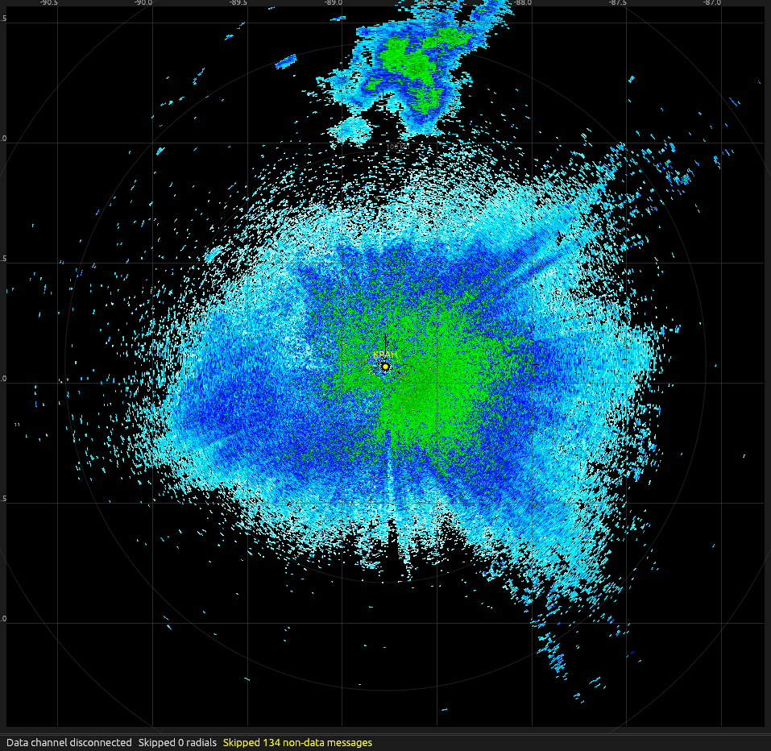

# oxrad

A free desktop weather, radar, and environmental observation workstation, written in Rust.



The screenshot is historical and does not show the current build.

oxrad runs on Linux, macOS, and Windows through `eframe` and `wgpu`. It has no account, subscription, advertisement, or paid tier. It is licensed under GPLv3.

## Status

This is a pre-release build. The radar display works. The product around it does not yet meet the standard of a professional workstation.

| Area | State |
|---|---|
| NEXRAD Level II decode and display | Working |
| Radar products and tilts | Working: seven moment products, every complete sweep |
| Radar history and playback | Working: eight recent volumes, loop, scrub |
| Offline vector basemap | Working at country scale only |
| Global radar composite | Working: RainViewer, two-hour loop |
| Forecast | Working: Open-Meteo, global |
| Place search | Working with exact names; live and fuzzy matching are not implemented |
| Warnings | United States only |
| Radar outside the United States | RainViewer composite only; no national Level II adapter |
| Units selection | Partial: distance and temperature convert; other quantities do not |
| Light theme | Not implemented |
| Layer management | Not implemented |
| Colourblind-safe palettes | Not implemented |
| Performance measurement | Not taken |

Do not use this build for safety decisions. Coverage, warnings, and geographic detail are incomplete.

The authoritative status record is [ROADMAP.md](ROADMAP.md). Requirements are in [docs/PRODUCT_REQUIREMENTS.md](docs/PRODUCT_REQUIREMENTS.md). Architecture is in [docs/ARCHITECTURE.md](docs/ARCHITECTURE.md).

## Build

```
cargo build --release --locked
```

Linux needs an X11 or Wayland client library, `libxkbcommon`, and a Vulkan loader and driver.

## Run

```
cargo run --release
oxrad --site KPAH
```

`--site` starts with that NEXRAD station instead of the saved one. `--help` prints usage.

## Use

The window has three regions.

The left rail holds place search, station selection, product and tilt, radar history, and active warnings. The centre is the workspace, switched between Radar and Map. The right panel holds the forecast for the selected place and the selected alert detail. The status bar names the station, product, scan time, scan age, gate counts, and provenance.

A town and a radar station are separate selections. Searching a town sets the forecast point. It also selects the nearest supported radar station, and changing the station afterwards leaves the forecast point unchanged.

Radar history pauses live acquisition while a scan is reviewed. Returning to live starts a fresh acquisition.

Map view overlays the selected station and up to three nearby stations when their scans fall within six minutes of the selected scan. Stations outside that window are withheld and named. This is a time-bounded overlay, not a value-composited mosaic.

## Configuration and stored data

| Path | Contents |
|---|---|
| `~/.oxrad/config.toml` | Selected site and saved place |
| `~/.oxrad/stations.json` | Last station directory and its save time |
| `~/.oxrad/cache/responses/v1` | Bounded, integrity-checked response cache |

The cache holds up to 256 entries and 128 MiB. Every body is verified against its SHA-256 digest before use.

## Data sources

| Source | Use | Coverage | Licence |
|---|---|---|---|
| Unidata NEXRAD Level II archive | Radar volumes | United States WSR-88D | Public domain |
| National Weather Service station directory | Station discovery | United States and territories | Public domain |
| National Weather Service active alerts | Warnings | United States and territories | Public domain |
| Open-Meteo | Forecast | Global | CC BY 4.0 |
| OpenStreetMap Nominatim | Place search | Global | ODbL |
| RainViewer | Reflectivity composite | 1,200 or more radars, 150 or more countries | Free terms, attribution required |

Attribution is displayed in the application. Details and researched but unintegrated sources are in [docs/DATA_SOURCES.md](docs/DATA_SOURCES.md).

Requests identify the client as `oxrad/<version> (https://github.com/bonzupii/oxrad)`. Place queries and forecast coordinates are not written to logs.

## Limitations

- Radar moments outside the United States are not decoded. No DWD, ECCC, BoM, JMA, CMA, IMD, OPERA, or ODIM reader exists.
- The basemap has no roads, streets, terrain, hydrography, or settlement detail.
- Radar range rings and the grid are not drawn in map view.
- Units cannot be switched. Forecast units are whatever the provider returns.
- There is one dark palette per product. No colourblind-safe alternative exists.
- Search requires Enter or the Search button and matches names rather than accepting partial or misspelled input.
- Warnings cover the United States and its territories only.
- Layers cannot be reordered, grouped, or made partially transparent. Warnings, global radar, and station overlays each have an independent toggle and nothing else.
- Pan and zoom performance has not been measured.

## Troubleshooting

| Symptom | Cause |
|---|---|
| Window fails to open | No Vulkan driver, or no X11 or Wayland client library |
| Station list empty | Discovery failed and no cached directory exists; the rail shows the error |
| Radar stays on an old scan | The feed failed; the status bar shows the failure and the scan age |
| Forecast missing | The place has no forecast from the provider; the panel shows the provider error |
| Cache warnings | The cache directory is not writable; live data still loads |

## Development

`STYLE.md` governs code and prose. `AGENTS.md` binds changes to the engineering constraints. `ROADMAP.md` records state and phases. `API.md` records the NEXRAD crate interface.

| Document | Contents |
|---|---|
| [docs/PRODUCT_REQUIREMENTS.md](docs/PRODUCT_REQUIREMENTS.md) | Personas, requirements, acceptance |
| [docs/ARCHITECTURE.md](docs/ARCHITECTURE.md) | Current structure, defects, target contracts |
| [docs/UI_DESIGN.md](docs/UI_DESIGN.md) | Tokens, layout, themes, QA matrix |
| [docs/DATA_SOURCES.md](docs/DATA_SOURCES.md) | Provider inventory and admission protocol |
| [docs/CACHING.md](docs/CACHING.md) | Cache classes and policy |
| [docs/TESTING.md](docs/TESTING.md) | Suite, gaps, verification layers |
| [docs/PERFORMANCE.md](docs/PERFORMANCE.md) | Targets, method, known costs |
| [docs/NETWORK.md](docs/NETWORK.md) | Network paths and limits |
| [docs/DEPENDENCIES.md](docs/DEPENDENCIES.md) | Direct dependencies |
| [docs/HEADLESS.md](docs/HEADLESS.md) | Headless graphical verification |

Gates:

```
cargo fmt --all -- --check
cargo clippy -- -D warnings
cargo test
cargo build
cargo build --release --locked
```

`cargo test` includes live network tests. A network failure fails the suite.

Copyright (C) 2026 Micah Ostrow <bonzupii@protonmail.com>. GPLv3.
